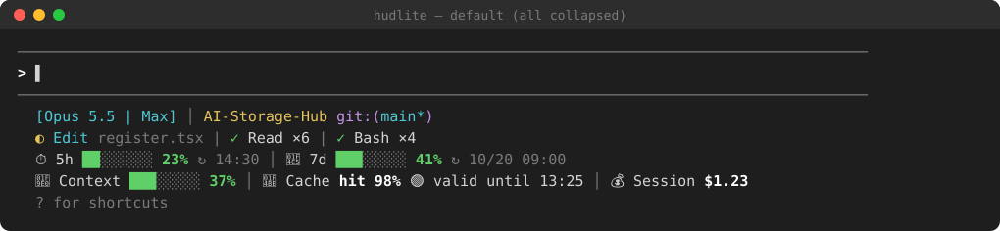
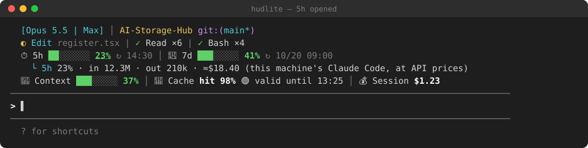
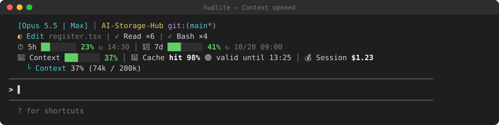
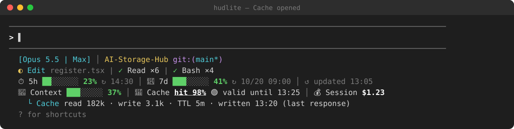
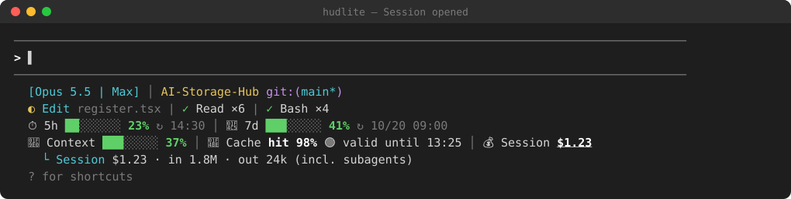
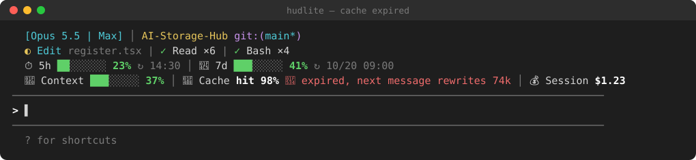

# hudlite

[繁體中文](README.md) · [简体中文](README.zh-CN.md) · **English**

A minimal status HUD (mod) for Claude Code.

hudlite is a trimmed version of [hoobnn's hud mod](https://github.com/hoobnn/hoobnn-agent-mods/tree/main/claude-code/hud), which ports [claude-hud](https://github.com/jarrodwatts/claude-hud) to a Claude Code mod. Almost all of hudlite's code comes from those two projects (both MIT licensed); hudlite only makes the changes listed below.



> The images are illustrations drawn from hudlite's actual layout and colors (SVG), with sample figures; the real look depends on your terminal's font and colors.

## What differs from the hud mod

- **Removed**: the 12 themes, the mascot, `/hud theme`, and claude-hud's context / usage line (replaced by the new rows below).
- **Kept**: everything else claude-hud shows (model, project and git, running tools, todos, alerts, the run-out forecast, the `/hud detail` pane…).
- **Two new rows**. Click any item to open its details; sending your next message folds them back:

| Item | Shown | Opened |
|---|---|---|
| ⏱ 5h | bar, percent used, ↻ reset time | input / output tokens, estimated cost |
| 📅 7d | same | same |
| ✨ per-model weekly limits (e.g. Fable, when you have one) | percent used, ↻ reset time | — |
| 🧠 Context | bar, percent used | tokens used / window size |
| 💾 Cache | hit rate, 🟢/🟡/🔴 state and expiry | read / write tokens, TTL, when written |
| 💰 Session | cost | input / output tokens (incl. subagents) |

Cache state: 🟢 `valid until 13:25`; 🟡 under 2 minutes left; 🔴 `expired, next message rewrites 74k` (the tokens your next message writes to the cache again).

## Screenshots

**5h opened**



**7d opened**


**Context opened**



**Cache opened**



**Session opened**



**Cache expired**



## Install

```sh
claude plugin marketplace add e950280/hudlite
claude plugin install hudlite@hudlite
```

Or inside Claude Code: `/plugin marketplace add e950280/hudlite`, then `/plugin install hudlite@hudlite`.

If you already have hoobnn's `hud` installed, use one or the other: both register `/hud`.

## Commands

| Command | What it does |
|---|---|
| `/hud` | Show / hide (toggle) |
| `/hud off`, `/hud on` | Hide, show |
| `/hud above`, `/hud below` | Above / below the prompt (where the status line sat) |
| `/hud lang en`, `zh-TW`, `zh-CN`, `auto` | Switch language (English / Traditional Chinese / Simplified Chinese / follow claude-hud's setting); no argument shows the current one |
| `/hud detail` | Open or close the details pane (tool times, recent turns, subagents, todos, spend) |

The "HUD" button in the prompt footer does what `/hud` does. Visibility, position and language are written back to `/config` and kept for next time.

## Options

Change them in `/config`, or under `pluginConfigs` in `~/.claude/settings.json`. The same as the hud mod's, without `theme` and `showMascot`: `visible`, `footerButton`, `position`, `language`, `contextAlerts`, `usageAlerts`, `showForecast`, `dailyBudgetUsd`, `showHistory`, `summaryEveryTurns`, `compactWarnPercent`, `coldCacheTokens`, `turnGrowthTokens`, `gitDirtyWarn`, `gitAheadWarn`, `showAgents`, `notifyAfterSeconds`, `notifySound`, `extraCmd`, `debug`.

**Language**: with `language` at `auto` (the default), the HUD follows claude-hud's own config file (`language` in `~/.claude/plugins/claude-hud/config.json`; English when unset). Set it to `en`, `zh-Hant` or `zh-Hans`, or use `/hud lang`, and claude-hud's lines switch together with hudlite's two rows.

## Where the numbers come from

- **5h / 7d percent, reset times, context percent, session cost**: from Claude Code itself, the same as `/usage` and `/cost`.
- **The 5h / 7d token counts and cost when opened**: hudlite sums this machine's transcripts (`~/.claude/projects/**/*.jsonl`) and prices them at Anthropic's API rates. **Only Claude Code on this machine counts** (not claude.ai on the web, not other computers), so they will not match the percent; a subscription is not billed at these amounts either. A window starts 5 hours / 7 days before it resets.
- **Input tokens** include cache reads and writes.
- **Cache expiry**: the last main-thread request's time plus that write's TTL (5m or 1h).

The first pass reads the last 7 days of transcripts (107 MB took about 0.4 s in testing); after that, every 30 seconds it reads only what was added, and only the lines that carry usage.

## Known limits

- The items are clicked with the mouse; they cannot be reached with Tab (so a clicked item does not stay highlighted).
- Needs `/bin/sh`, `tail`, `head` and `awk` (built into macOS and Linux); untested on Windows.

## Development

```sh
claude plugin validate .
claude plugin test .
claude --plugin-dir .      # start a session with this folder loaded
```

## License

MIT, see [LICENSE](LICENSE). claude-hud's original license is in [LICENSE.claude-hud](LICENSE.claude-hud).
