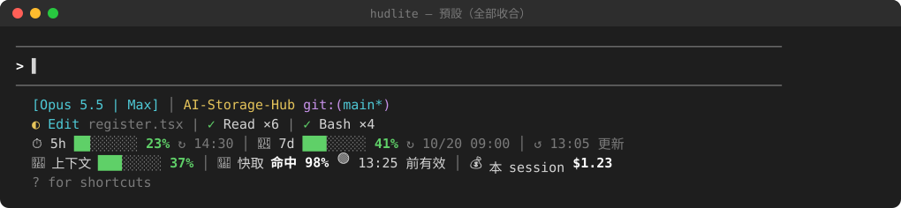
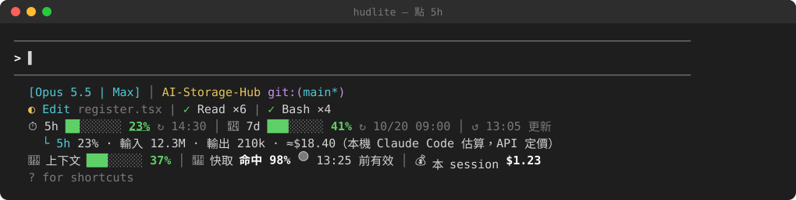
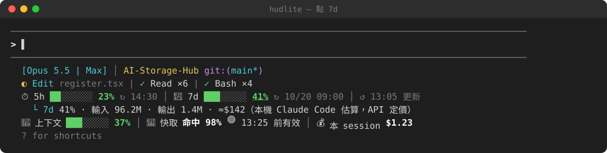
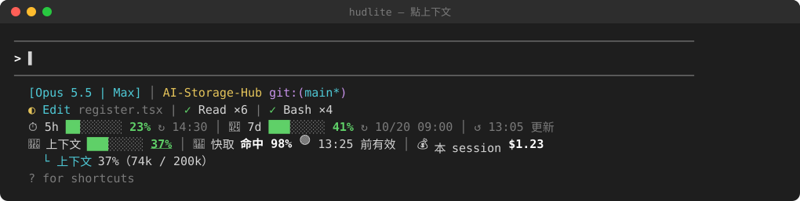
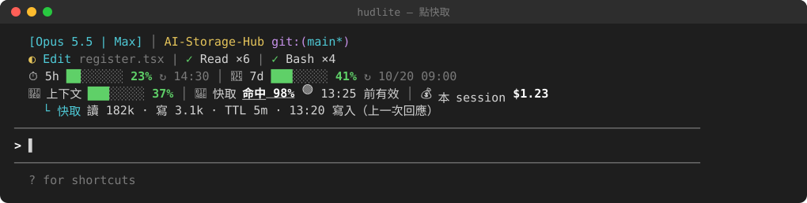
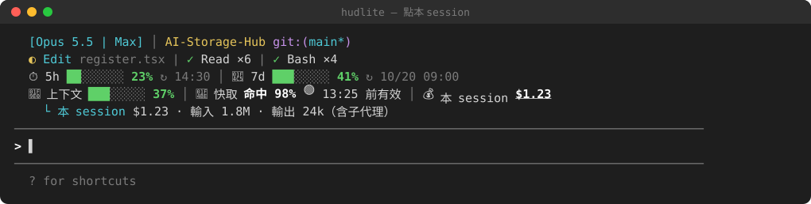
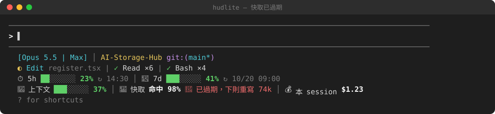

# hudlite

**繁體中文** · [简体中文](README.zh-CN.md) · [English](README.en.md)

Claude Code 的極簡狀態列 HUD（mod）。支援 10 種語言：English、繁體中文、简体中文、日本語、한국어、Español、Français、Deutsch、Português (Brasil)、Русский。

hudlite 是 [hoobnn 的 hud mod](https://github.com/hoobnn/hoobnn-agent-mods/tree/main/claude-code/hud) 的精簡版；那個 mod 又是把 [claude-hud](https://github.com/jarrodwatts/claude-hud) 改寫成 Claude Code mod。hudlite 的程式碼絕大部分來自這兩個專案（兩者皆為 MIT 授權），hudlite 只做了下面列出的改動。



> 圖片是依 hudlite 實際的版面與配色畫成的示意圖（SVG），數字為範例；實際外觀依你的終端機字型與配色而定。

## 跟 hud mod 的差別

- **拿掉**：12 套主題、看板娘、`/hud theme`，以及 claude-hud 的「上下文／用量」那一行（由下面的新列取代）。
- **保留**：claude-hud 其餘的資訊（模型、專案與 git、正在跑的工具、待辦、預警、用完預測、`/hud detail` 面板…）。
- **新增兩列**，每一項都可以用滑鼠點開詳細資料，送出下一則訊息時自動收合：

| 項目 | 平常顯示 | 點開後 |
|---|---|---|
| ⏱ 5h | 進度條、使用 %、↻ 重置時間 | 輸入／輸出 token、估算花費 |
| 📅 7d | 同上 | 同上 |
| ✨ 按模型的週額度（如 Fable，有才顯示） | 使用 %、↻ 重置時間 | — |
| ↺ 更新時間 | 5h／7d 讀數是幾點的：灰＝正常、黃＝超過 5 分鐘、紅 ⚠＝查詢失敗 | 點一下立刻查詢（如 `/usage`） |
| 🧠 上下文 | 進度條、使用 % | 已用 / 視窗大小 token |
| 💾 快取 | 命中 %、🟢/🟡/🔴 狀態與到期時間 | 讀／寫 token、TTL、寫入時間 |
| 💰 本 session | 花費 | 輸入／輸出 token（含子代理） |

快取狀態：🟢 `13:25 前有效`；🟡 剩不到 2 分鐘；🔴 `已過期，下則重寫 74k`（下一則訊息要重新寫入快取的 token 數）。

## 截圖

**點 5h**（7d 相同）



**點 7d**



**點上下文**



**點快取**



**點本 session**



**快取已過期**



## 安裝

```sh
claude plugin marketplace add e950280/hudlite
claude plugin install hudlite@hudlite
```

或在 Claude Code 裡：`/plugin marketplace add e950280/hudlite`，再 `/plugin install hudlite@hudlite`。

若已裝了 hoobnn 的 `hud`，請擇一使用：兩者都註冊 `/hud` 指令。

## 指令

| 指令 | 作用 |
|---|---|
| `/hud` | 顯示／隱藏（切換） |
| `/hud off`、`/hud on` | 隱藏、顯示 |
| `/hud above`、`/hud below` | 放到輸入框上方／下方（原本 status line 的位置，預設） |
| `/hud lang <語言>` | 切換語言：`en`、`zh-TW`、`zh-CN`、`ja`、`ko`、`es`、`fr`、`de`、`pt-BR`、`ru`，或 `auto`（跟 claude-hud 設定）；不帶參數顯示目前語言 |
| `/hud detail` | 開關詳細面板（工具耗時、最近幾輪、子代理、待辦、花費） |

輸入框底欄的「HUD」按鈕等同 `/hud`。開關、位置與語言會寫回 `/config`，下次沿用。

## 選項

在 `/config` 修改，或寫在 `~/.claude/settings.json` 的 `pluginConfigs`。與 hud mod 相同（扣掉 `theme`、`showMascot`）：`visible`、`footerButton`、`position`、`language`、`contextAlerts`、`usageAlerts`、`showForecast`、`dailyBudgetUsd`、`showHistory`、`summaryEveryTurns`、`compactWarnPercent`、`coldCacheTokens`、`turnGrowthTokens`、`gitDirtyWarn`、`gitAheadWarn`、`showAgents`、`notifyAfterSeconds`、`notifySound`、`extraCmd`、`debug`。

**語言**：`language` 設為 `auto`（預設）時，跟著 claude-hud 自己的設定檔（`~/.claude/plugins/claude-hud/config.json` 的 `language`；沒設定就是英文）。設成 `en`、`zh-Hant`、`zh-Hans`、`ja`、`ko`、`es`、`fr`、`de`、`pt-BR`、`ru`，或用 `/hud lang`，claude-hud 那幾行與 hudlite 的兩列會一起切換。

## 數字從哪來、準不準

- **5h / 7d 的 %、重置時間**：所有 session 共用一份最新的讀數。來源有二：每個 session 對話時回應附帶的數字（不額外發請求），以及每 2 分鐘向 Claude Code 的用量服務查一次（與 `/usage` 同一個服務）；這台機器不管開幾個 session，都只查一次。被拒絕（429）時自動退避。
  - 這個服務有流量限制：實測每 10 秒、每 1 分鐘會被擋，每 2 分鐘（4.5 小時、134 次）與每 5 分鐘都沒問題；被擋時 `/usage` 也可能暫時查不到。
- **上下文 %、本 session 花費**：Claude Code 本身提供，與 `/cost` 一致。
- **5h / 7d 點開後的 token 數與金額**：hudlite 掃描本機 `~/.claude/projects/**/*.jsonl` 對話紀錄加總，以 Anthropic API 定價估算。**只含這台機器上的 Claude Code**（不含 claude.ai 網頁、其他電腦），所以和 % 不會對上；訂閱方案實際也不是照這個金額計費。視窗起點 = 重置時間往前 5 小時／7 天。
- **輸入 token** 包含快取讀取與寫入的 token。
- **快取到期時間**：最後一次主對話請求的時間 + 該次寫入的 TTL（5m 或 1h）。

第一次統計會讀過去 7 天的紀錄（實測 107 MB 約 0.4 秒），之後每 30 秒只讀新增的部分；只取出含用量的那幾行。

## 已知限制

- 按鈕只能用滑鼠點，不能 Tab 選取（為了避免點過的按鈕一直反白）。
- 需要 `/bin/sh`、`tail`、`head`、`awk`（macOS、Linux 內建）；Windows 未測試。

## 開發

```sh
claude plugin validate .
claude plugin test .
claude --plugin-dir .      # 用這個資料夾直接啟動
```

## 授權

MIT，見 [LICENSE](LICENSE)。claude-hud 原始授權見 [LICENSE.claude-hud](LICENSE.claude-hud)。
