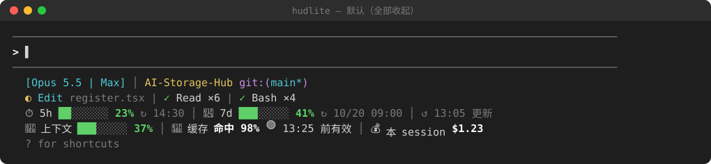
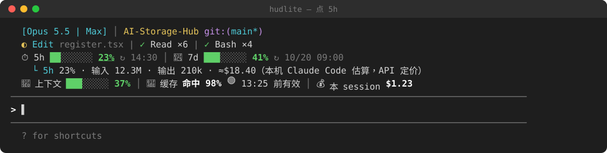
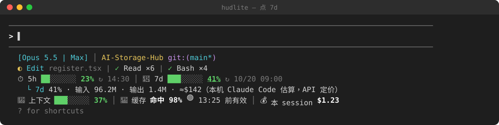
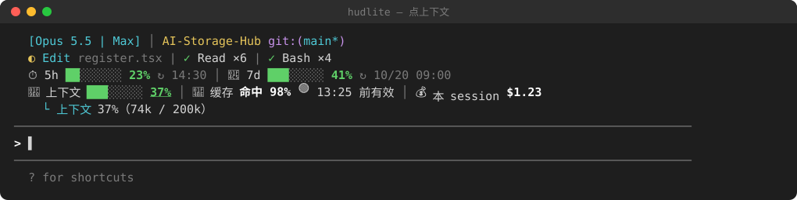
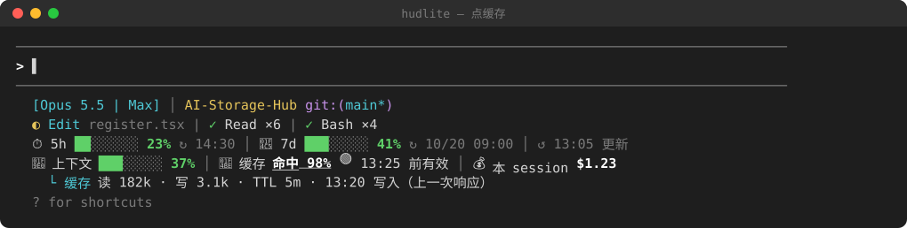
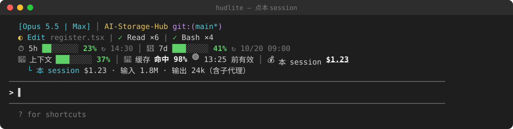
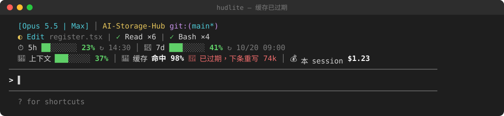

# hudlite

[繁體中文](README.md) · **简体中文** · [English](README.en.md)

Claude Code 的极简状态栏 HUD（mod）。支持 10 种语言：English、繁體中文、简体中文、日本語、한국어、Español、Français、Deutsch、Português (Brasil)、Русский。

hudlite 是 [hoobnn 的 hud mod](https://github.com/hoobnn/hoobnn-agent-mods/tree/main/claude-code/hud) 的精简版；那个 mod 又是把 [claude-hud](https://github.com/jarrodwatts/claude-hud) 改写成 Claude Code mod。hudlite 的代码绝大部分来自这两个项目（两者均为 MIT 许可证），hudlite 只做了下面列出的改动。



> 图片是按 hudlite 实际的布局与配色绘制的示意图（SVG），数字为示例；实际外观取决于你的终端字体与配色。

## 与 hud mod 的区别

- **去掉**：12 套主题、看板娘、`/hud theme`，以及 claude-hud 的「上下文／用量」那一行（由下面的新行取代）。
- **保留**：claude-hud 其余的信息（模型、项目与 git、正在运行的工具、待办、预警、用完预测、`/hud detail` 面板…）。
- **新增两行**，每一项都可以用鼠标点开详细信息，发送下一条消息时自动收起：

| 项目 | 平时显示 | 点开后 |
|---|---|---|
| ⏱ 5h | 进度条、使用 %、↻ 重置时间 | 输入／输出 token、估算花费 |
| 📅 7d | 同上 | 同上 |
| ✨ 按模型的周额度（如 Fable，有才显示） | 使用 %、↻ 重置时间 | — |
| 🧠 上下文 | 进度条、使用 % | 已用 / 窗口大小 token |
| 💾 缓存 | 命中 %、🟢/🟡/🔴 状态与到期时间 | 读／写 token、TTL、写入时间 |
| 💰 本 session | 花费 | 输入／输出 token（含子代理） |

缓存状态：🟢 `13:25 前有效`；🟡 剩不到 2 分钟；🔴 `已过期，下条重写 74k`（下一条消息要重新写入缓存的 token 数）。

## 截图

**点 5h**



**点 7d**



**点上下文**



**点缓存**



**点本 session**



**缓存已过期**



## 安装

```sh
claude plugin marketplace add e950280/hudlite
claude plugin install hudlite@hudlite
```

或在 Claude Code 里：`/plugin marketplace add e950280/hudlite`，再 `/plugin install hudlite@hudlite`。

如果已经装了 hoobnn 的 `hud`，请二选一：两者都注册 `/hud` 命令。

## 命令

| 命令 | 作用 |
|---|---|
| `/hud` | 显示／隐藏（切换） |
| `/hud off`、`/hud on` | 隐藏、显示 |
| `/hud above`、`/hud below` | 放到输入框上方／下方（原本 status line 的位置，默认） |
| `/hud lang <语言>` | 切换语言：`en`、`zh-TW`、`zh-CN`、`ja`、`ko`、`es`、`fr`、`de`、`pt-BR`、`ru`，或 `auto`（跟随 claude-hud 设置）；不带参数显示当前语言 |
| `/hud detail` | 开关详情面板（工具耗时、最近几轮、子代理、待办、花费） |

输入框底栏的「HUD」按钮等同 `/hud`。开关、位置与语言会写回 `/config`，下次沿用。

## 选项

在 `/config` 修改，或写在 `~/.claude/settings.json` 的 `pluginConfigs`。与 hud mod 相同（去掉 `theme`、`showMascot`）：`visible`、`footerButton`、`position`、`language`、`contextAlerts`、`usageAlerts`、`showForecast`、`dailyBudgetUsd`、`showHistory`、`summaryEveryTurns`、`compactWarnPercent`、`coldCacheTokens`、`turnGrowthTokens`、`gitDirtyWarn`、`gitAheadWarn`、`showAgents`、`notifyAfterSeconds`、`notifySound`、`extraCmd`、`debug`。

**语言**：`language` 为 `auto`（默认）时，跟随 claude-hud 自己的配置文件（`~/.claude/plugins/claude-hud/config.json` 的 `language`；没设置就是英文）。设为 `en`、`zh-Hant`、`zh-Hans`、`ja`、`ko`、`es`、`fr`、`de`、`pt-BR`、`ru`，或用 `/hud lang`，claude-hud 那几行与 hudlite 的两行会一起切换。

## 数字从哪来、准不准

- **5h / 7d 的 %、重置时间、上下文 %、本 session 花费**：Claude Code 本身提供，与 `/usage`、`/cost` 一致。
- **5h / 7d 点开后的 token 数与金额**：hudlite 扫描本机 `~/.claude/projects/**/*.jsonl` 对话记录汇总，按 Anthropic API 定价估算。**只含这台机器上的 Claude Code**（不含 claude.ai 网页、其他电脑），所以和 % 对不上；订阅方案实际也不是按这个金额计费。窗口起点 = 重置时间往前 5 小时／7 天。
- **输入 token** 包含缓存读取与写入的 token。
- **缓存到期时间**：最后一次主对话请求的时间 + 该次写入的 TTL（5m 或 1h）。

第一次统计会读取过去 7 天的记录（实测 107 MB 约 0.4 秒），之后每 30 秒只读新增的部分；只取出含用量的那几行。

## 已知限制

- 按钮只能用鼠标点，不能 Tab 选中（为了避免点过的按钮一直反白）。
- 需要 `/bin/sh`、`tail`、`head`、`awk`（macOS、Linux 自带）；Windows 未测试。

## 开发

```sh
claude plugin validate .
claude plugin test .
claude --plugin-dir .      # 直接用这个文件夹启动
```

## 许可证

MIT，见 [LICENSE](LICENSE)。claude-hud 原始许可证见 [LICENSE.claude-hud](LICENSE.claude-hud)。
